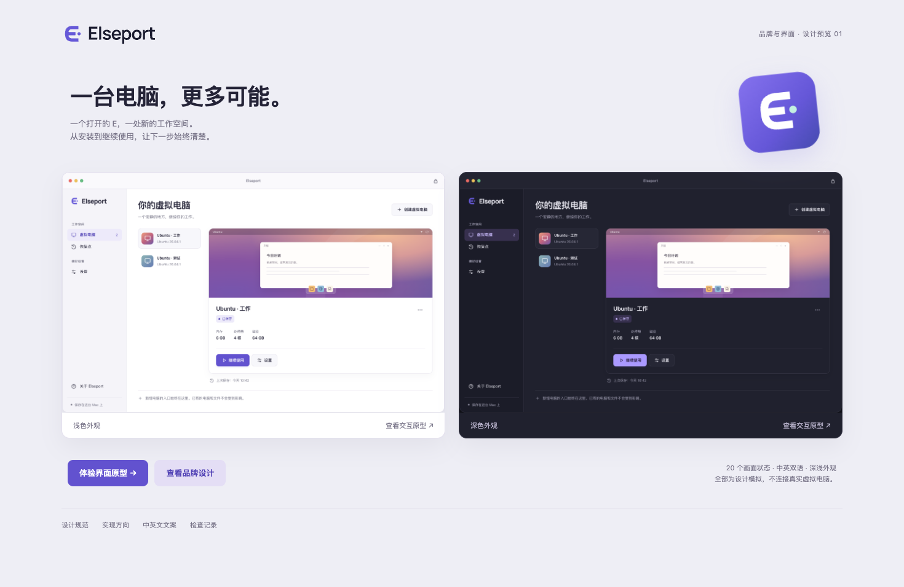

# Elseport

An independent desktop virtualisation project for Apple Silicon Macs, built
from the open-source code of VirtualBox.

[简体中文](README.zh-CN.md) · [Build](doc/elseport/BUILDING.md) · [Security](SECURITY.md)



*Design preview. This interface has not yet replaced the existing frontend.*

## Development status

This is a source-first open-source project; no public binary is designated as
supported. Current work covers guided
setup, desktop integration and the new interface. Claims below are limited to
the configurations actually tested.

| Area | Status |
| --- | --- |
| Guided Ubuntu installation | Validated in the local development branch; the guided installer is not included in this initial public source snapshot |
| Computer lifecycle | Start, stop, pause, save and resume exercised with dedicated test machines |
| Shared folders | Available through the existing backend; share only explicitly selected folders |
| New interface | Interactive English/Chinese, light/dark prototype; not integrated |
| File clipboard | Files and directories passed both directions between macOS and an isolated Linux X11 clipboard; see the [scope and limits](doc/elseport/INTEGRATION.md) |
| Retina | Automatic 200% GNOME desktop scale with native pixels verified in the single-monitor test configuration |
| Drag and drop | macOS preparation and conversion implemented; Finder interoperability still needs manual validation |
| Linux 3D | Basic drawing and pixel checks passed with source-built Guest Additions; off by default, with application and game compatibility unverified |
| Distribution | Source and build instructions; local development packaging is optional |

## Requirements

The development baseline is an Apple M2 running macOS 27.0.1. Guest examples
use Ubuntu 26.04.1 Arm64. Other hardware and OS versions need their own
validation. This project does not provide a different-architecture system
emulator.

The current bundled development build requires macOS 27.0 or later because
of its Qt dependencies. Only macOS 27.0.1 has been tested.

Source builds require Apple development tools, kBuild, Qt and the dependencies
in the [build guide](doc/elseport/BUILDING.md). The 3D path needs an additional
toolchain. A development build is not a supported installation package.

## Try the design

This preview is local and does not create or control virtual computers:

```sh
python3 -m http.server 8765 --bind 127.0.0.1 --directory doc/design
```

Open `http://127.0.0.1:8765/` and use example data only. See the
[design specification](doc/design/DESIGN.md) and
[prototype validation](doc/design/VALIDATION.md).

## Build and test

Follow [BUILDING.md](doc/elseport/BUILDING.md). Keep development configuration
and test machines separate from an existing installation. Helpers do not
install system dependencies or change the selected developer-tool directory.
The [validation record](doc/elseport/VALIDATION.md) lists completed checks and
remaining manual coverage.

The [release checklist](doc/elseport/RELEASE.md) records the conditions for
distribution. A generated development disk image is an internal test artifact.

## Known limits

- The new interface and branding are not fully integrated.
- Wayland file clipboard, external displays and application-level graphics
  compatibility need further work or validation.
- The Ubuntu installer currently uses upstream Guest Additions 7.2.22.
- Real keyboard input, accessibility tools, external displays and sleep/wake
  need hands-on testing.
- Source publication does not require an App Store release or Apple signing
  identity. Public binary downloads would need their own packaging, licensing
  and platform validation.
- The proprietary Extension Pack is not included or required by this scope.

## Origin and license

This work starts from VirtualBox `7.2.97r175247`, Git mirror revision
`b6bea72111fcff48f31c57c9f66365b1d3301bb9`. The canonical upstream repository
is SVN; its Git mirror may lag it.

Covered code is licensed under GNU GPL version 3. Third-party components retain
their own licenses. See [COPYING](COPYING), [LICENSE.txt](LICENSE.txt),
[NOTICE](NOTICE) and [dependency notes](doc/elseport/DEPENDENCIES.md). Existing
copyright and license notices are retained.

Elseport is not affiliated with, endorsed by or sponsored by Oracle. Oracle
and VirtualBox are trademarks of Oracle and/or its affiliates. Mac and macOS
are trademarks of Apple Inc. Ubuntu is a trademark of Canonical Ltd. References
identify origin or compatibility context, not endorsement.

Read [CONTRIBUTING.md](CONTRIBUTING.md) before preparing a change. Do not disclose
possible vulnerabilities in public issues, patches or comments; follow
[SECURITY.md](SECURITY.md).
