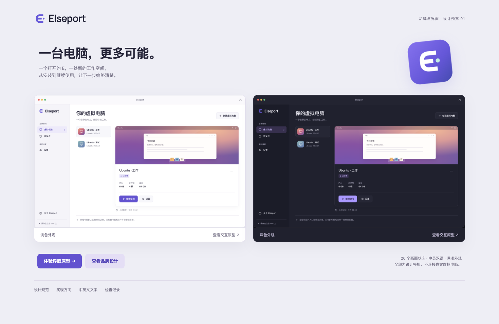

# Elseport

面向 Apple Silicon Mac 的独立桌面虚拟化项目，基于 VirtualBox 开源代码开发。

[English](README.md) · [源码构建](doc/elseport/BUILDING.md) · [安全报告](SECURITY.md)



*这是设计预览，新的 Elseport 界面尚未替换现有前端。*

## 当前状态

这是以源码为主要交付的开源项目，目前没有标为正式支持的公开安装包。以下能力仅以实际验证的配置为准。

| 范围 | 状态 |
| --- | --- |
| 引导安装 Ubuntu | 已在本地开发分支验证；引导安装器未纳入这个初始公开源码快照 |
| 虚拟电脑生命周期 | 已在专用测试环境验证启动、停止、暂停、保存与恢复路径 |
| 共享文件夹 | 使用现有后端；只共享用户主动选择的目录 |
| 新界面 | 中英文、深浅色交互原型，尚未接入正式应用 |
| 文件复制粘贴 | macOS 与隔离的 Linux X11 剪贴板之间，双向文件和目录传输已验证；见[适用范围和限制](doc/elseport/INTEGRATION.md) |
| Retina | 单显示器测试配置中，GNOME 自动 200% 缩放与原生像素输出已验证 |
| 拖放 | 已实现 macOS 数据准备和转换；Finder 互操作仍需人工验证 |
| Linux 3D | 使用源码构建的增强工具通过基础绘制和像素检查；默认关闭，应用和游戏兼容性未验证 |
| 分发 | 源码与构建说明；本地开发打包为可选项 |

## 系统要求

开发验证基线为 Apple M2、macOS 27.0.1，客体示例为 Ubuntu 26.04.1 Arm64。
其他硬件和版本需要单独验证。本项目不提供异构架构的系统模拟器。

当前本地开发包受 Qt 依赖限制，最低需要 macOS 27.0；实际测试版本为 27.0.1。

源码构建需要 Apple 开发工具、kBuild、Qt 等依赖，详见
[构建说明](doc/elseport/BUILDING.md)。3D 路径需要额外工具链。
本地开发构建不等同于受支持的安装包。

## 查看设计

原型在本机模拟界面，不会创建或操作真实虚拟电脑：

```sh
python3 -m http.server 8765 --bind 127.0.0.1 --directory doc/design
```

打开 `http://127.0.0.1:8765/`，表单只填写示例数据。
[设计规范](doc/design/DESIGN.md)和[检查记录](doc/design/VALIDATION.md)
说明原型与实际产品的区别。

## 构建与测试

按[BUILDING.md](doc/elseport/BUILDING.md)操作。测试配置和虚拟电脑必须与已有安装隔离。
助手脚本不自动安装系统依赖，也不修改系统的开发工具选择。
[验证记录](doc/elseport/VALIDATION.md)列出了已完成的检查和仍需人工验证的范围。

[发布清单](doc/elseport/RELEASE.md)列出正式分发前的条件。
生成的本地开发磁盘映像是内部测试产物，不是公开下载。

## 已知限制

- 新界面和品牌尚未完整集成。
- Wayland 文件剪贴板、外接显示器、实际应用的图形兼容性仍需开发或验证。
- Ubuntu 安装流程当前使用上游预编译的 Guest Additions 7.2.22。
- 真实键盘、辅助功能、外接显示器和休眠唤醒需要人工测试。
- 公开源码不需要上架 App Store，也不以 Apple 签名身份为前提。若以后提供公开二进制下载，需要单独完成打包、许可和平台验证。
- 不附带专有 Extension Pack，当前范围也不依赖它。

## 来源与许可

基于 VirtualBox `7.2.97r175247`，Git 镜像修订
`b6bea72111fcff48f31c57c9f66365b1d3301bb9`。上游以 SVN 为准，Git 镜像可能滞后。

受覆盖的代码采用 GNU GPL 第三版；第三方组件保留各自许可证。详见
[COPYING](COPYING)、[LICENSE.txt](LICENSE.txt)、[NOTICE](NOTICE)和
[依赖说明](doc/elseport/DEPENDENCIES.md)。已有版权和许可声明予以保留。

Elseport 与 Oracle 没有关联、认可或赞助关系。Oracle 和 VirtualBox 是 Oracle
和/或其关联公司的商标。Mac、macOS 是 Apple Inc. 的商标。Ubuntu 是 Canonical
Ltd. 的商标。名称用于说明来源或兼容背景，不代表获得认可。

贡献前阅读[CONTRIBUTING.md](CONTRIBUTING.md)。可能的安全问题按
[SECURITY.md](SECURITY.md)私下处理，不在公开 issue、补丁或评论中披露。
